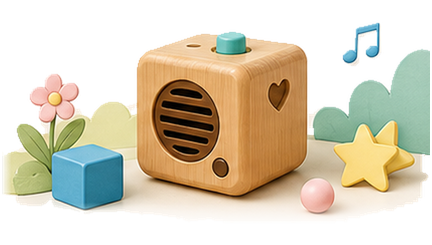

<p align="center">
  
</p>

# SweetYaar

SweetYaar is a small music box that lives inside a doll. A child presses one
button for songs and another for animal sounds. Parents choose what it plays,
how loud and when it winds down for the night from a remote app on their phone,
and the same doll doubles as a Bluetooth speaker.

It works entirely on its own: no account, no Wi-Fi and no cloud. Songs and
sounds live on a microSD card, so the content can change without touching the
software.

**[Parents' guide (PDF)](docs/SweetYaar_Parents_Guide.pdf)** · **[Open the parent remote](https://sweetyaar.zachmoshe.com)** · **[Real-life findings](docs/findings/README.md)**

## Using SweetYaar

### The child's buttons

| Do this | And the doll |
| --- | --- |
| Press the song button | plays a song from the current theme; press again for the next one |
| Press the animal button | plays an animal sound; press again for the next one |
| Press both buttons | stops |
| Hold both buttons for 3 seconds | opens Bluetooth pairing for a minute |

When nobody plays with it, the doll goes to sleep on its own. A button press
wakes it.

### The parent remote

Open [sweetyaar.zachmoshe.com](https://sweetyaar.zachmoshe.com) in Chrome or
Edge (on Android or a computer) and connect to the doll. The remote can:

- start, stop and skip songs, and set the volume;
- pick the song theme and turn continuous play on;
- pause the child's buttons for a ten-minute Quiet time;
- run Bedtime: a gentler theme and lower volume on a schedule;
- show the battery and charging state, and install firmware updates.

It can be installed to the home screen and keeps working offline. The
[Parents' guide](docs/SweetYaar_Parents_Guide.pdf) walks through all of it.

### As a Bluetooth speaker

Pair a phone or computer with the doll (hold both buttons for 3 seconds), then
play anything to it. While a phone streams, the doll's buttons are ignored;
disconnect it to return to the doll's own songs.

### Battery

A full charge lasts about **34 hours** of songs from the card, or about
**15 hours** of Bluetooth streaming. The remote shows the battery level. See
the [battery report](docs/findings/battery-under-stress/battery-under-stress.pdf)
for how this was measured.

## Real-life findings

Reports of experiments on real devices, written for anyone who wants to know
how the toy actually behaves: [docs/findings](docs/findings/README.md).

## How it is made

| Part | What it is | Read more |
| --- | --- | --- |
| Firmware | ESP32-WROOM-32, C++ on PlatformIO/Arduino: playback, Bluetooth, buttons, sleep | [Firmware](docs/engineering/firmware.md) |
| Parent remote | A Web Bluetooth app, installable and offline | [Mobile app](docs/engineering/mobile-app.md) |
| Electronics | A custom board with charger, power switching and amplifier | [Hardware](docs/engineering/hardware.md) |
| Diagnostics | An on-device flash log, its upload and a log viewer | [Logging and debugging](docs/logging-and-debugging.md) |

For the story of the project and its design principles, read the
[project overview](docs/overview.md).

---

## For developers

### Setup and common commands

```bash
make setup
```

`make help` lists every command. The most common ones:

```bash
make app            # Serve the parent app at http://localhost:8000/
make build          # Build the complete ESP32 firmware
make flash          # Build and upload to a connected ESP32
make monitor        # Open the serial monitor
make test           # Run the full regression suite
make test-unit      # Host-only tests; never flashes or touches hardware
make test-device    # Approved real-device tests (see tests/README.md)
```

Variables can be overridden per invocation, for example `make app APP_PORT=8080`
or `make monitor SERIAL_PORT=/dev/cu.SLAB_USBtoUART`.

### Repository layout

- `firmware/esp32/`: PlatformIO project and firmware source.
- `app/`: the Web Bluetooth parent remote and its design assets.
- `hardware/`: KiCad projects for the mainboard and debugger, libraries, enclosure models and datasheet index.
- `tests/`: host-side pytest, native C++, app and firmware-build tests.
- `tools/`: utilities such as the device test runner, log tools and audio converters.
- `docs/`: the engineering guides, findings and overview.

### History

`main` is the current ESP32 firmware. Two older versions are kept as branches:
`v1.0`, the previous MicroPython implementation, and `v0.0`, an earlier
educational snapshot (`git switch v1.0`).
